<b>How to read the isle</b>

 

The scene is redrawn every 30 minutes by a GitHub Action from the live weather in Lisbon and my public GitHub data. Everything is drawn pixel by pixel in [`avalon/`](avalon), with no image assets.

| In the scene | What it shows |
|---|---|
| Sky, sun and moon | The real time of day in Lisbon, with the sun and moon where they actually are and the real moon phase |
| Clouds, rain, snow, fog, thunder | The current weather |
| Windmill, flag and banners | They turn and wave with the real wind speed and direction |
| **The Rune Wall** | My contribution calendar for the last year: one stone per day, glowing brighter on busier days. Today's stone blinks |
| **The beacon** on the keep | My contributions in the last 7 days. It burns bigger the more I ship and goes cold after a quiet week |
| **Banners** | My most-used languages across public repositories |
| **Allies** on the battlements | My followers |
| **The guardian's eyes** | Green: active this week. Amber: quiet for over a week. Red: away for over a month |
| Chimney smoke, lit windows, torches | Lit when it's cold, or once the sun goes down |
| Level and XP | One XP per contribution, ever |

The trees change with the seasons, and a few dates bring their own surprises.

**Game developer from Portugal** · Unity & LÖVE · C, C#, Java, Python, Lua · web with HTML, CSS, JavaScript and PHP

  

